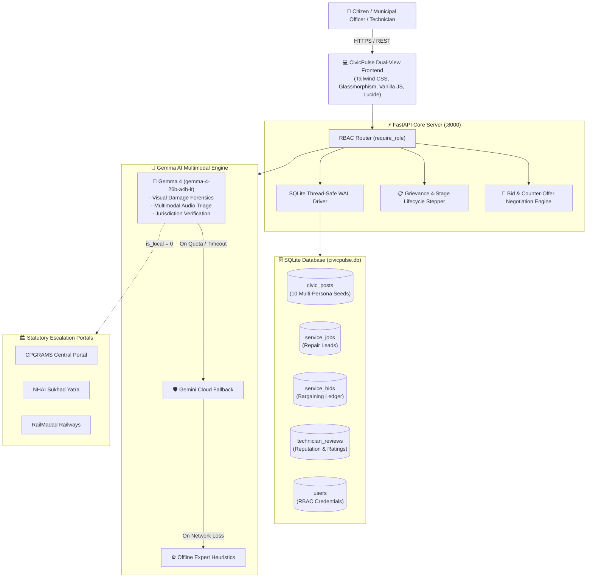

<div align="center">


# 🏛️ CivicPulse
### Multimodal Civic Infrastructure Triage & Hyperlocal Home Utility Marketplace

[](LICENSE)
[](https://ai.google.dev/gemma)
[](https://www.python.org/)
[](https://fastapi.tiangolo.com/)
[](https://www.sqlite.org/)
[](https://tailwindcss.com/)
[](https://github.com/Ayush-git800/Civic-Pulse)

<p align="center">
  <b>Bridging neglected municipal infrastructure and unregulated household repairs through open-weight multimodal intelligence.</b>
</p>

[Quickstart](#-quickstart--local-setup) • [Today's Implementations](#-changes--key-implementations-done-today) • [Why Gemma?](#-the-role--architecture-of-gemma) • [Core Features](#-core-features) • [System Architecture](#-system-architecture) • [Future Roadmap](#-future-roadmap--architectural-scaling) • [Judge Evaluation](#-hackathon-evaluation--fast-pass) • [Team](#-built-by-team-version-controllers)

---

</div>

> 🤖 **Artificial Intelligence Disclosure:**  
> **This project was engineered and synthesized with advanced AI pair-programming (Google Antigravity & Gemini)**. From relational schemas, Pydantic validation, and multi-tier LLM fallback pipelines to responsive glassmorphic UI, forensic photo inspection, and real-time negotiation engines, CivicPulse demonstrates how human civic vision paired with agentic intelligence can construct production-grade public utility infrastructure in record time.

---

## 👥 Built by Team **Version Controllers**

Submitted for **Google Gemma Hackathon 2026**:
- 🏆 **Open Source Category**
- 🌟 **Best Use of Gemma Category**

| Team Member | Project Role | Responsibilities |
| :--- | :--- | :--- |
| **Ayush Chauhan** | Team Leader & System Architect | Full-Stack Core, Negotiation Engine, Gemma 4 Integration |
| **Rishav Ranjan** | AI & Backend Engineer | Multimodal Triage Pipeline, REST API & RBAC Guards |
| **Hardik Kumar** | Frontend & UX Lead | Responsive Glassmorphism, Stepper Tracker & Voice-to-Triage |

---

## 🌟 Changes & Key Implementations Done Today

Here is the breakdown of the major architectural and functional systems designed, integrated, and verified today:

```
┌──────────────────────────────────────────────────────────────────────────────────────────────────┐
│                                 TODAY'S CORE UPGRADES AT A GLANCE                                 │
├───────────────────────────────────┬──────────────────────────────────┬───────────────────────────┤
│ 1. REAL-TIME NEGOTIATION ENGINE   │ 2. DUAL-TAB SOCIAL CIVIC FEED    │ 3. GRIEVANCE LIFECYCLE    │
│ • Two-way Citizen/Tech bargaining │ • Public Community Feed (All)    │ • 4-stage tracking stepper│
│ • Auto-rejection of rivals on deal│ • "My Reported Issues" isolation │ • Officer field note logs │
│ • Escrow contract rate lock       │ • Dynamic upvoting & counters    │ • 1-click legal RTI export│
├───────────────────────────────────┼──────────────────────────────────┼───────────────────────────┤
│ 4. STRICT ROLE-GATED RBAC         │ 5. REPUTATION & RATING SYSTEM    │ 6. AUTHENTIC MEDIA ASSETS │
│ • Isolated role dashboards        │ • 1-5 Star verified feedback     │ • 10 relatable hazard pics│
│ • X-User-Role FastAPI headers     │ • Completed works counter ledger │ • Pothole, cable, sewer,  │
│ • Evaluator Fast-Pass Bar         │ • Weighted contractor ranking    │   debris, tree, manhole   │
└───────────────────────────────────┴──────────────────────────────────┴───────────────────────────┘
```

### 1. Two-Way Bid & Counter-Offer Negotiation Engine
- **Relational Schema Enhancement (`service_bids`)**: Dynamic schema migration added `initial_bid`, `current_amount`, `last_action_by` (`'TECHNICIAN'` or `'CITIZEN'`), `status` (`'PENDING'`, `'COUNTERED'`, `'ACCEPTED'`, `'REJECTED'`), `technician_id`, `technician_name`, and `technician_trade`.
- **Bidirectional Bargaining Endpoints**:
  - `POST /api/services/{id}/bid`: Technician submits initial quotation.
  - `POST /api/services/bids/{id}/counter`: Citizen or Technician counters back (`actor_role: 'CITIZEN' | 'TECHNICIAN'`).
  - `POST /api/services/bids/{id}/accept`: Either actor finalizes deal; system marks winning bid `ACCEPTED`, locks final agreed rate into `service_jobs.final_price`, **automatically auto-rejects all competing bids** as `REJECTED`, advances job to `IN_PROGRESS`, and increments the technician's completed works count.
- **Dynamic Frontend State Machine**:
  - **Citizen View**: Live quote received $\rightarrow$ `[✅ Accept Deal]` or `[💬 Counter Offer]`. If countered $\rightarrow$ `⏳ Waiting for technician response (Your Counter: ₹X)`. Deal confirmed card with direct contractor dialer.
  - **Technician View**: Citizen counter alert $\rightarrow$ `🔥 Customer Countered with ₹X` with `[✅ Accept ₹X & Lock Payout]` and `[🔄 Re-Counter]` button with inline mid-point counter proposal input.

### 2. Community Social Feed + "My Reported Issues" Dual-Tab View
- **Dual-View Navigation Bar (`frontend/index.html` & `app.js`)**:
  - Tab 1: `🌐 Community Feed (All Reports)` — displays verified citizen hazard reports from across the municipality.
  - Tab 2: `👤 My Reported Issues (<span id="myReportsBadgeCount">X</span>)` — isolated personal dashboard showing issues reported by the authenticated citizen.
- **Dynamic Civic Upvoting**: `POST /api/civic/{id}/upvote` increments priority metrics with instant optimistic UI feedback.
- **Authentic Photographic Evidence**: Replaced generic placeholders with 10 high-resolution, problem-specific photographs across 8 wards (pothole, overflowing compactor, high-voltage cable, water main burst, dark streetlights, open manhole, cracked sidewalk, sewer overflow, fallen tree limb, and construction debris).

### 3. Multi-Stage Civic Grievance Lifecycle Tracker & RTI Generator
- **Interactive 4-Stage Stepper**:
  $$\text{Reported} \longrightarrow \text{Acknowledged} \longrightarrow \text{In Progress} \longrightarrow \text{Resolved}$$
- Real-time SLA resolution countdown clock, assigned field squad inspector tags, and official audit log notes.
- **One-Click Formal RTI Legal Letter Generation**: Pre-fills jurisdictional officer designations, incident coordinates, and statutory time-bound compliance notices according to Section 6(1) of the Right to Information Act, 2005.

### 4. Strictly Role-Gated Access Control (RBAC) & Dedicated Auth Gateway
- Dedicated route system: `#/` (Landing Page), `#/auth` (Sign In & Fast-Pass), `#/citizen` (Citizen Dashboard), `#/municipal` (Municipal Command Center), and `#/technician` (Technician Workspace).
- Route guards prevent cross-role tampering with persistent session storage in `localStorage`.
- FastAPI dependency injection (`require_role(...)`) enforces `X-User-Role` verification on all mutation endpoints.

### 5. Verified Technician Reputation, Rating & Work History Ledger
- Relational schema `technician_reviews` linking ratings (1-5 stars), citizen feedback, and job IDs.
- Recalculates weighted average rating scores and increments `works_completed` counters upon contract delivery.

---

## 🏆 Hackathon Evaluation & Fast-Pass

> ⚡ **Judges & Evaluators Quickstart**:  
> Navigate to `#/auth` on the local web server (`http://localhost:8000/#/auth`) to view the **⚡ Evaluator Fast-Pass Bar**. A single click instantly seeds session credentials and launches you into any isolated role dashboard:
> - **[👤 Citizen Demo]**: Ayush Chauhan (Ward 9 - Sector 62) $\rightarrow$ `#/citizen`
> - **[🛡️ Municipal Officer]**: Er. Rajesh Mathur (Jal Board & PWD) $\rightarrow$ `#/municipal`
> - **[🔧 Technician Lead]**: Ramesh Sharma (4.9★ Master Plumber) $\rightarrow$ `#/technician`

---

## 📌 The Problem & The Solution

Citizens encounter two interconnected friction points every single day:

```
                    THE URBAN INFRASTRUCTURE DILEMMA
┌───────────────────────────────────────┐ ┌───────────────────────────────────────┐
│     OUTSIDE: Public Civic Hazards     │ │    INSIDE: Private Household Repair   │
│  - Crater potholes, dangling cables   │ │  - Cracked pipes, burning MCB breakers│
│  - Unclear municipal jurisdiction    │ │  - Opaque contractor visit charges   │
│  - Red tape: Central vs. Local body   │ │  - Price gouging with zero benchmarks │
└───────────────────┬───────────────────┘ └───────────────────┬───────────────────┘
                    │                                         │
                    ▼                                         ▼
┌─────────────────────────────────────────────────────────────────────────────────┐
│                      CIVICPULSE MULTIMODAL UNIFIED HUB                          │
│   • Gemma 4 Multimodal Visual Auditing  • Fair Price Bracket Estimation         │
│   • Automated Non-Municipal Escalation • Real-time 2-Way Contractor Bidding    │
│   • 4-Stage Transparent Civic Stepper  • Escrow Rate Contract Locks             │
└─────────────────────────────────────────────────────────────────────────────────┘
```

1. **Outside the Home:** When a physical hazard occurs (snapped high-voltage wire near a school, massive crater on a national highway), citizens do not know whether the municipal corporation, state PWD, NHAI, or Indian Railways has statutory jurisdiction. Complaints get passed around or ignored.
2. **Inside the Home:** When an appliance or utility breaks, residents must blindly trust neighborhood contractors who inflate prices with arbitrary visit fees and zero transparent standards.

**CivicPulse** solves both problems on a single unified platform using **Gemma 4 Multimodal AI** as an impartial civic auditor and transparent labor cost estimator.

---

## 🧠 The Role & Architecture of Gemma

CivicPulse relies on **Gemma 4** (`gemma-4-26b-a4b-it`), Google's state-of-the-art open-weight multimodal model, powered by the official `google-genai` SDK.

### 1. Forensic Visual Inspection
Instead of asking non-technical citizens to classify complex engineering faults, citizens simply snap a photo. Gemma 4 reads the raw image bytes alongside local context to:
- Detect physical structural degradation (spalling concrete, water pipe micro-fractures, exposed copper filaments).
- Determine departmental ownership across 5 municipal categories:
  - 🛣️ *Roads & Transport*
  - 🗑️ *Solid Waste & Sanitation*
  - 💧 *Water Supply & Sewage*
  - ⚡ *Electricity & Public Lighting*
  - 🌳 *Horticulture & Public Works*
- Assign objective hazard severity: `Low`, `Moderate`, `High`, or `Critical`.

### 2. Autonomous Jurisdiction Routing & Central Escalation
Municipal corporations cannot legally repair assets belonging to statutory central authorities. Gemma evaluates the spatial context in the photo and description:
- **National Highways (NHAI / MoRTH):** Attaches direct links to **Sukhad Yatra / NHAI Citizen Portal** and **CPGRAMS**.
- **Railway Crossings / Stations:** Attaches direct escalation to **RailMadad (Ministry of Railways)**.
- **Interstate / Central Govt Assets:** Routes directly to **CPGRAMS (Apex Central Portal)**.
- **Consumer Disputes:** Routes to **National Consumer Helpline (NCH)**.

### 3. Fair Price Engineering for Home Repairs
When homeowners post photos of defective plumbing, faulty MCB breakers, or swollen wooden doors, Gemma 4:
- Diagnoses the root failure mechanism (e.g., *“PVC u-trap compression washer decayed due to chemical cleaner erosion”*).
- Calculates realistic Indian fair market labor + minor parts price brackets (e.g., `₹350 - ₹550`).
- Provides critical safety instructions (e.g., *“Shut off main electrical isolator before touching breaker box”*).

### 4. Multi-Tier Resilient Inference Pipeline
To ensure high availability under rate limits or network drops, CivicPulse features a multi-tiered failover:
```
[User Request] ──► Gemma 4 (gemma-4-26b-a4b-it) [Primary Open-Weight Target]
                       │
                       ▼ (If quota / latency spike)
                   Gemini 2.5 / 1.5 Flash [Fast Cloud Fallback]
                       │
                       ▼ (If network offline)
                   Deterministic Heuristic Expert Engine [Offline Resilience]
```

---

## ✨ Core Features

### 🌐 1. Community Civic Infrastructure Feed & Lifecycle Stepper
- **Laser Scanner Upload:** Animated holographic laser line sweeps across uploaded evidence photos while Gemma audits the incident.
- **Interactive Full-Screen Lightbox:** Click any evidence photo to open high-resolution forensic zoom mode.
- **4-Stage Stepper & SLA Monitor:** Tracks tickets across *Reported $\rightarrow$ Acknowledged $\rightarrow$ In Progress $\rightarrow$ Resolved* with live countdown timer.
- **Citizen Engagement:** Upvote reports to boost priority ranking, flag critical safety emergencies, and participate in public comment threads.
- **Automated RTI Generator:** Generates legally structured Section 6(1) Right to Information grievance letters in 1 click.

### ⚡ 2. Hyperlocal Home Utility Repairs & Bargaining Engine
- **Instant AI Diagnosis:** Upload photo/audio to get instant defect diagnosis and fair cost brackets.
- **Live Bid & Counter-Offer Negotiation:** Real-time back-and-forth price negotiation between resident and contractor.
- **Escrow Contract Finalization:** When a deal is agreed upon, the contract rate is locked, competing bids are automatically marked rejected, and the client's direct contact details are unlocked.
- **Technician Reputation Ledger:** Verified homeowner star ratings (1-5★) and written reviews after completed works.

### 🎙️ 3. CivicTalk: Multilingual Voice-to-Triage (Audio AI)
- Built-in browser audio recording capturing dialect-heavy, spoken grievances in Hindi, English, and regional vernaculars.
- Automatic transcription and multimodal prompt routing via Gemma 4 Audio.

### 💬 4. PulseBot AI Ombudsman
- Floating copilot drawer powered by real-time conversational AI.
- Helps residents triage whether an issue is private or public.
- Advises citizens on evidence photo angles and lighting to maximize municipal compliance.

---

## 🏗️ System Architecture



---

## 🔮 Future Roadmap & Architectural Scaling

While the current implementation operates smoothly on a self-contained zero-docker stack (FastAPI + SQLite WAL), the following architectural evolution is planned for enterprise city-scale deployment:

```
┌──────────────────────────────────────────────────────────────────────────────────────────────────┐
│                                 ENTERPRISE SCALING ROADMAP                                       │
├───────────────────────────────────┬──────────────────────────────────┬───────────────────────────┤
│ 1. ENTERPRISE DATABASE LAYER      │ 2. ZERO-LATENCY REAL-TIME PUB/SUB│ 3. SMART ESCROW CONTRACTS │
│ • PostgreSQL 16 + PostGIS         │ • Redis Pub/Sub Cluster          │ • UPI 2.0 Mandate / Auto  │
│ • TimescaleDB for SLA telemetry   │ • FastAPI WebSockets             │ • Milestone-based payouts │
├───────────────────────────────────┼──────────────────────────────────┼───────────────────────────┤
│ 4. ON-DEVICE EDGE GEMMA 4         │ 5. GOVTECH & E-GOVERNANCE HOOKS  │ 6. NATIVE MOBILE APP      │
│ • MediaPipe LLM on Android        │ • CPGRAMS / Swachhata Webhooks   │ • Flutter / React Native  │
│ • Zero-bandwidth village audits   │ • DigiLocker / Aadhaar e-KYC     │ • Offline background sync │
└───────────────────────────────────┴──────────────────────────────────┴───────────────────────────┘
```

### 1. Enterprise Database Layer (PostgreSQL 16 + PostGIS + TimescaleDB)
- **PostgreSQL 16 + PostGIS**: Transition from SQLite to PostgreSQL with PostGIS extensions to enable spatial queries, automated municipal ward polygon geofencing (`ST_Contains`), and radius-based technician lead alerts (`ST_DWithin`).
- **TimescaleDB Telemetry**: Store microsecond audit logs for civic resolution velocity, officer response times, and predictive SLA bottleneck forecasting.

### 2. Zero-Latency Real-Time Pub/Sub & WebSockets
- **Redis Pub/Sub**: Replace client-side HTTP polling with an event-driven Redis Pub/Sub cluster.
- **FastAPI WebSockets**: Instant bidirectional push notifications for live price counter-offers, contractor acceptance alerts, and municipal dispatch updates in sub-50 milliseconds.

### 3. Smart Contract Escrow & UPI Auto-Pay
- **Razorpay Route / UPI Intent Mandates**: When a deal is accepted, funds are held in a Reserve Bank of India (RBI) compliant escrow account.
- **Two-Factor Work Completion Release**: Funds are automatically disbursed to the technician upon citizen OTP verification or GPS proof-of-work geofencing.

### 4. Edge Multimodal Gemma 4 for Low-Connectivity Areas
- **On-Device Quantized Gemma (Gemma 4 INT4)**: Deployed directly on Android devices via Google MediaPipe LLM Inference Engine.
- Enables rural citizens in poor cellular connectivity zones to audit broken borewells, canals, and roads offline, auto-syncing when network connectivity restores.

### 5. GovTech & Statutory Integration
- **Direct API Webhooks**: Bi-directional integration with CPGRAMS, Swachhata-MoHUA, and State Jansunwai portals for cross-system status synchronization.
- **DigiLocker / Aadhaar e-KYC**: Verified resident identities to prevent spam grievances and verified tradesperson license verification.

---

## 🔌 REST API Reference

All endpoints return structured JSON with strict Pydantic v2 validation. Interactive Swagger UI is available at `/docs`.

### Civic Grievance Endpoints
| Method | Endpoint | Description | Payload / Params |
| :--- | :--- | :--- | :--- |
| `GET` | `/api/civic/feed?filter=all` | List all community civic reports with comment threads | Query `filter=all` |
| `GET` | `/api/civic/feed?filter=mine&citizen_id={id}` | Retrieve grievances reported by authenticated user | Query `filter=mine` |
| `POST` | `/api/civic/report` | Upload image for Gemma 4 multimodal hazard inspection | `FormData`: `image`, `description`, `location_city` |
| `POST` | `/api/civic/{id}/upvote` | Boost community priority score | Path `id` |
| `POST` | `/api/civic/{id}/status` | Municipal officer transitions complaint lifecycle | `{"status": "ACKNOWLEDGED"\|"IN_PROGRESS"\|"RESOLVED", "officer_note": str}` |
| `POST` | `/api/civic/{id}/comment` | Add citizen witness statement | `{"author": str, "comment": str}` |

### Home Utility Marketplace & Negotiation Endpoints
| Method | Endpoint | Description | Payload / Params |
| :--- | :--- | :--- | :--- |
| `GET` | `/api/services/jobs` | List all household repair requests and technician bids | None |
| `POST` | `/api/services/create` | Upload defect media for AI diagnosis and price bracket | `FormData`: `media`, `description`, `location_city` |
| `POST` | `/api/services/{id}/bid` | Technician submits quote on open defect lead | `{"amount": int, "notes": str, "technician_id": int}` |
| `POST` | `/api/services/bids/{id}/counter` | Resident or technician submits revised counter-offer | `{"counter_amount": int, "actor_role": "CITIZEN"\|"TECHNICIAN"}` |
| `POST` | `/api/services/bids/{id}/accept` | Finalize contract, lock rate, auto-reject rivals | `{"job_id": str, "final_price": str}` |
| `GET` | `/api/technician/{phone}/jobs` | Technician workspace: active bids, leads, confirmed contracts | Path `phone` |

### Technician Reputation Endpoints
| Method | Endpoint | Description | Payload / Params |
| :--- | :--- | :--- | :--- |
| `GET` | `/api/technicians` | Retrieve all registered technicians with rating and works count | None |
| `GET` | `/api/technicians/{id}/reviews` | Retrieve verified citizen feedback and rating breakdown | Path `id` |
| `POST` | `/api/technicians/{id}/reviews` | Submit verified 1-5 star review after job completion | `{"service_id": int, "rating": int, "review_text": str}` |

---

## 🚀 Quickstart & Local Setup

### Prerequisites
- Python 3.9, 3.10, or 3.11
- A Google Gemini / Gemma API key ([Get one free at Google AI Studio](https://aistudio.google.com/))

### 1. Clone & Enter Repository
```bash
git clone https://github.com/Ayush-git800/Civic-Pulse.git
cd Civic-Pulse
```

### 2. Create & Activate Virtual Environment
```bash
python3 -m venv .venv

# On macOS / Linux:
source .venv/bin/activate

# On Windows:
.venv\Scripts\activate
```

### 3. Install Dependencies
```bash
pip install -r requirements.txt
```

### 4. Configure Environment Variables
Create a `.env` file in the root directory:
```bash
cp .env.example .env
```
Edit `.env` and paste your Gemini API key:
```ini
GEMINI_API_KEY=your_gemini_api_key_here
```

### 5. Launch CivicPulse
```bash
uvicorn backend.main:app --host 0.0.0.0 --port 8000 --reload
```

Open your browser at:
- 🌐 **Web Application:** [http://localhost:8000](http://localhost:8000)
- 📚 **Interactive Swagger API Docs:** [http://localhost:8000/docs](http://localhost:8000/docs)
- 🔍 **Health Status:** [http://localhost:8000/api/health](http://localhost:8000/api/health)

---

## 📂 Project Structure

```text
civic-pulse/
├── backend/
│   ├── __init__.py
│   ├── config.py           # Environment loader & upload folder configuration
│   ├── database.py         # Thread-safe SQLite driver, WAL mode, dynamic migrations, seeds
│   ├── gemma_service.py    # Gemma 4 multimodal auditor, fallback chain, PulseBot
│   ├── main.py             # FastAPI REST router, static asset mounter, RBAC middleware
│   └── models.py           # Pydantic v2 validation models
├── frontend/
│   ├── index.html          # Dual-view architecture (Landing Page + Multi-Role Workspace)
│   └── static/
│       ├── css/
│       │   └── style.css   # Glassmorphism, animations, glow badges, custom scrollbars
│       ├── images/
│       │   ├── logo.png    # Official Option 4.8 high-contrast brand mark
│       │   └── demo/       # 12 authentic, problem-specific civic & repair photographs
│       └── js/
│           └── app.js      # RBAC router, negotiation state machine, RTI generator, Lucide
├── scripts/
│   └── generate_judge_dossier.py # Publication-grade ReportLab PDF compiler
├── uploads/                # Local persistent storage for citizen evidence photos
├── requirements.txt        # Production dependencies (FastAPI, Gemma, ReportLab, Pillow)
└── README.md               # Master documentation, architecture guide & hackathon pitch
```

---

## 🛡️ License

This project is licensed under the **Apache License 2.0** — see the [LICENSE](LICENSE) file for details.

---

<div align="center">
  <b>CivicPulse • Engineered by Team Version Controllers for the Google Gemma Hackathon 🏛️</b>
</div>
