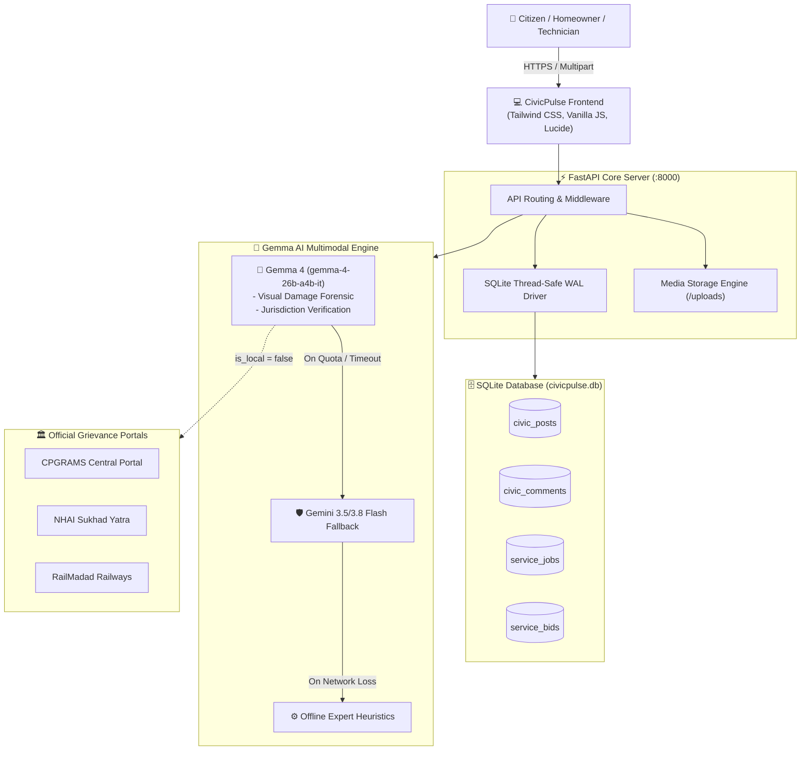

<div align="center">

# 🏛️ CivicPulse
### Multimodal Civic Infrastructure Triage & Hyperlocal Home Utility Marketplace

[](LICENSE)
[](https://ai.google.dev/gemma)
[](https://www.python.org/)
[](https://fastapi.tiangolo.com/)
[](https://www.sqlite.org/)
[](https://tailwindcss.com/)
[](https://github.com)

<p align="center">
  <b>Bridging neglected municipal infrastructure and unregulated household repairs through open-weight multimodal intelligence.</b>
</p>

[Quickstart](#-quickstart--local-setup) • [Why Gemma?](#-the-role--architecture-of-gemma) • [Core Features](#-core-features) • [System Architecture](#-system-architecture) • [API Specs](#-rest-api-reference) • [Team](#-built-by-team-version-controllers)

---

</div>

> 🤖 **Artificial Intelligence Disclosure:**  
> **This project was engineered and synthesized with advanced AI pair-programming (Antigravity & Gemini)**. From database schemas, Pydantic validation, and multi-tier LLM fallback pipelines to the responsive Tailwind UI, micro-animations, and forensic photo scanner, CivicPulse showcases how human vision and modern AI engineering can solve real-world civic challenges in record time.

---

## 👥 Built by Team **Version Controllers**

Submitted for **Hacktoberfest Hackathon 2026**:
- 🏆 **Open Source Category**
- 🌟 **Best Use of Gemma Category**

| Team Member | Roles |
| :--- | :--- |
| **Ayush Chauhan** | Team Leader |
| **Rishav Ranjan** | Member 1 |
| **Hardik Kumar** | Member 2 |

---

## 🏆 Hackathon Evaluation & Recent Feature Changelog

> ⚡ **Judges & Evaluators Quickstart**:  
> Navigate to `#/auth` on the local web server (`http://localhost:8000/#/auth`) to view the **⚡ Evaluator Fast-Pass Bar**. A single click instantly seeds session credentials and launches you into any isolated role dashboard:
> - **[👤 Citizen Demo]**: Ayush Chauhan (Ward 150 - Bellandur) -> `#/citizen`
> - **[🛡️ Municipal Officer]**: Officer Rajesh Rao (BBMP HQ) -> `#/municipal`
> - **[🔧 Technician Lead]**: Ramesh Kumar (4.9★ Electrician) -> `#/technician`

### 📋 Architectural Upgrade Summary:
1. **Strict Role-Based Access Control (RBAC) & Dedicated Auth Gateway (`#/auth`)**:
   - Replaced open public switcher bars with strict route-level protection (`#/`, `#/auth`, `#/citizen`, `#/municipal`, `#/technician`).
   - Dynamic form schemas customized for Citizens (contact & locality), Municipal Authorities (officer ID & department jurisdiction), and Verified Technicians (trade category & standard hourly rates).
   - Route guards actively block unauthorized cross-role tampering (e.g. citizens attempting to access `#/municipal` receive immediate 403-style UI toast blocks and auto-redirection).
   - Authenticated operations header displaying user initial avatar, full name, role pill, and a tactile Sign Out action that purges local session state.

2. **Backend Endpoint Protection (`backend/main.py`)**:
   - Enforces `X-User-Role` verification via FastAPI dependency injection (`require_role(...)`).
   - Incident triage and field squad assignments (`POST` / `PUT /api/civic/{id}/status`) restricted exclusively to `municipal` officers (`HTTP 403 Forbidden` on role breach).
   - Household repair quote submissions (`POST /api/services/{id}/bid`) restricted exclusively to `technician` accounts.

3. **Technician Reputation & Review Pipeline (`backend/database.py`, `backend/main.py`)**:
   - Added `works_completed`, `rating`, and `review_count` attributes to the SQLite `users` table, backed by a relational `technician_reviews` schema.
   - Dynamic review submission endpoint (`POST /api/technicians/{id}/reviews`) automatically recalculates running average ratings and increments verified job counters.
   - Tactile star rating modals allow citizens to rate completed jobs with real-time feedback loop.

4. **Standalone Consumer Landing Page & Asset Fidelity**:
   - High-contrast visual architecture with soft radiant ambient meshes, micro-animations, and interactive RTI legal grievance showcase.
   - Enhanced Option 4.8 brand mark rendering (`/static/images/logo.png`) with contrast-optimized crisp borders.

---

## 📌 The Problem & The Solution

Citizens encounter two interconnected friction points every single day:

```
                    THE URBAN INFRASTRUCTURE DILEMMA
┌───────────────────────────────────────┐ ┌───────────────────────────────────────┐
│     OUTSIDE: Public Civic Hazards     │ │    INSIDE: Private Household Repair   │
│  - Crater potholes, dangling cables   │ │  - Cracked pipes, burning MCB breakers│
│  - Unclear municipal jurisdiction    │ │  - Opaque contractor visit charges   │
│  - Red tape: Central vs. Local body   │ │  - Price gouging with zero benchmarks │
└───────────────────┬───────────────────┘ └───────────────────┬───────────────────┘
                    │                                         │
                    ▼                                         ▼
┌─────────────────────────────────────────────────────────────────────────────────┐
│                      CIVICPULSE MULTIMODAL UNIFIED HUB                          │
│   • Gemma 4 Multimodal Visual Auditing  • Fair Price Bracket Estimation         │
│   • Automated Non-Municipal Escalation • Real-time 2-Way Contractor Bidding    │
└─────────────────────────────────────────────────────────────────────────────────┘
```

1. **Outside the Home:** When a physical hazard occurs (snapped high-voltage wire near a school, massive crater on a national highway), citizens do not know whether the municipal corporation, state PWD, NHAI, or Indian Railways has statutory jurisdiction. Complaints get passed around or ignored.
2. **Inside the Home:** When an appliance or utility breaks, residents must blindly trust neighborhood contractors who inflate prices with arbitrary visit fees and zero transparent standards.

**CivicPulse** solves both problems on a single unified platform using **Gemma 4 Multimodal AI** as an impartial civic auditor and transparent labor cost estimator.

---

## 🧠 The Role & Architecture of Gemma

CivicPulse relies on **Gemma 4** (`gemma-4-26b-a4b-it`), Google's state-of-the-art open-weight multimodal model, powered by the official `google-genai` SDK.

### 1. Forensic Visual Inspection
Instead of asking non-technical citizens to classify complex engineering faults, citizens simply take a photo. Gemma 4 reads the raw image bytes alongside local context to:
- Detect physical structural degradation (spalling concrete, water pipe micro-fractures, exposed copper filaments).
- Determine departmental ownership across 5 municipal categories:
  - 🛣️ *Roads & Transport*
  - 🗑️ *Solid Waste & Sanitation*
  - 💧 *Water Supply & Sewage*
  - ⚡ *Electricity & Streetlights*
  - 🛡️ *Public Health & Encroachment*
- Assign objective hazard severity: `Low`, `Moderate`, `High`, or `Critical`.

### 2. Autonomous Jurisdiction Routing & Central Escalation
Municipal corporations cannot legally repair assets belonging to statutory central authorities. Gemma evaluates the spatial context in the photo and description:
- **National Highways (NHAI / MoRTH):** Attaches direct links to **Sukhad Yatra / NHAI Citizen Portal** and **CPGRAMS**.
- **Railway Crossings / Stations:** Attaches direct escalation to **RailMadad (Ministry of Railways)**.
- **Interstate / Central Govt Assets:** Routes directly to **CPGRAMS (Apex Central Portal)**.
- **Consumer Disputes:** Routes to **National Consumer Helpline (NCH)**.

### 3. Fair Price Engineering for Home Repairs
When homeowners post photos of defective plumbing, faulty MCB breakers, or swollen wooden doors, Gemma 4:
- Diagnoses the root failure mechanism (e.g., *“PVC u-trap compression washer decayed due to chemical cleaner erosion”*).
- Calculates realistic Indian fair market labor + minor parts price brackets (e.g., `₹350 - ₹550`).
- Provides critical safety instructions (e.g., *“Shut off main electrical isolator before touching breaker box”*).

### 4. Multi-Tier Resilient Inference Pipeline
To ensure high availability under rate limits or network drops, CivicPulse features a multi-tiered failover:
```
[User Request] ──► Gemma 4 (gemma-4-26b-a4b-it) [Primary Open-Weight Target]
                       │
                       ▼ (If quota / latency spike)
                   Gemini 3.5 Flash / Gemini 3.8 Flash [Fast Cloud Fallback]
                       │
                       ▼ (If network offline)
                   Deterministic Heuristic Expert Engine [Offline Resilience]
```

---

## ✨ Core Features

### 🌐 1. Community Civic Infrastructure Feed
- **Laser Scanner Upload:** Animated holographic laser line sweeps across uploaded evidence photos while Gemma audits the incident.
- **Interactive Full-Screen Lightbox:** Click any evidence photo to open high-resolution forensic zoom mode.
- **Real-Time Search & Category Filter Pills:** Filter by *Roads*, *Sanitation*, *Water*, *Electricity*, or *Central Jurisdiction*.
- **Citizen Engagement:** Upvote reports to boost priority ranking, flag critical safety emergencies, and participate in public comment threads.
- **Ticket ID Copy:** One-click clipboard utility to share grievance IDs on external municipal portals.

### ⚡ 2. Hyperlocal Home Utility Repairs & Bargaining Engine
- **Instant AI Diagnosis:** Upload photo/video to get instant defect diagnosis and fair cost brackets.
- **Live Two-Way Bidding:** Neighborhood technicians submit bids with contact numbers.
- **Interactive Counter-Offer System:** Residents can submit a counter-offer; either party can click **"Accept Deal"** to finalize the contract.
- **Emerald Deal Glow:** Visual tactile confirmation when contracts are successfully locked.
- **Judge/Demo Tool:** Built-in simulation tool allowing hackathon judges to simulate technician bids in 1 click.

### 💬 3. PulseBot AI Ombudsman
- Floating copilot drawer powered by real-time conversational AI.
- Helps residents triage whether an issue is private or public.
- Advises citizens on evidence photo angles and lighting to maximize municipal compliance.
- Informs users about fair market technician visit rates across Indian metropolitan and Tier-2 cities.

### 🛡️ 4. Fail-Safe Offline SVG Graphic Engine
- If an external CDN image is blocked by firewalls or offline, the UI automatically renders a vector SVG badge tailored to the exact category with zero broken image placeholders.

---

## 🏗️ System Architecture



---

## 🔌 REST API Reference

All endpoints return structured JSON with full Pydantic v2 validation. Interactive Swagger UI is available at `/docs`.

### Civic Grievance Endpoints
| Method | Endpoint | Description | Payload / Params |
| :--- | :--- | :--- | :--- |
| `GET` | `/api/civic/posts` | List all community civic reports with comment threads | None |
| `POST` | `/api/civic/report` | Upload image for Gemma 4 multimodal hazard inspection | `FormData`: `image`, `description`, `location_city`, `lat`, `lng` |
| `POST` | `/api/civic/{id}/upvote` | Boost community urgency ranking | Path `id` |
| `POST` | `/api/civic/{id}/urgent` | Flag as critical municipal safety hazard | Path `id` |
| `POST` | `/api/civic/{id}/comment` | Add citizen witness statement or update | `{"author": str, "comment": str}` |

### Home Utility Marketplace Endpoints
| Method | Endpoint | Description | Payload / Params |
| :--- | :--- | :--- | :--- |
| `GET` | `/api/services/jobs` | List all household repair requests and technician bids | None |
| `POST` | `/api/services/create` | Upload defect media for AI diagnosis and price bracket | `FormData`: `media`, `description`, `location_city` |
| `GET` | `/api/services/{id}/bids` | Retrieve all bids for a specific job | Path `id` |
| `POST` | `/api/services/{id}/bid` | Contractor submits quote on open defect | `{"worker_name": str, "worker_phone": str, "bid_amount": int}` |
| `POST` | `/api/services/bids/{id}/counter` | Resident sends counter-offer | `{"counter_amount": int}` |
| `POST` | `/api/services/bids/{id}/accept` | Accept quote, lock contract rate | `{"job_id": str, "final_price": str}` |

### PulseBot AI & System
| Method | Endpoint | Description | Payload / Params |
| :--- | :--- | :--- | :--- |
| `POST` | `/api/chat` | Real-time multi-turn conversation with PulseBot | `{"message": str, "history": list}` |
| `GET` | `/api/health` | Healthcheck endpoint confirming API status | None |

---

## 🚀 Quickstart & Local Setup

### Prerequisites
- Python 3.9, 3.10, or 3.11
- A Google Gemini / Gemma API key ([Get one free at Google AI Studio](https://aistudio.google.com/))

### 1. Clone & Enter Repository
```bash
git clone https://github.com/ayush/civic-pulse.git
cd civic-pulse
```

### 2. Create & Activate Virtual Environment
```bash
python3 -m venv .venv

# On macOS / Linux:
source .venv/bin/activate

# On Windows:
.venv\Scripts\activate
```

### 3. Install Dependencies
```bash
pip install -r requirements.txt
```

### 4. Configure Environment Variables
Create a `.env` file in the root directory:
```bash
cp .env.example .env
```
Edit `.env` and paste your Gemini API key:
```ini
GEMINI_API_KEY=your_gemini_api_key_here
```

### 5. Launch CivicPulse
```bash
uvicorn backend.main:app --host 0.0.0.0 --port 8000 --reload
```

Open your browser at:
- 🌐 **Web Application:** [http://localhost:8000](http://localhost:8000)
- 📚 **Interactive Swagger API Docs:** [http://localhost:8000/docs](http://localhost:8000/docs)
- 🔍 **Health Status:** [http://localhost:8000/api/health](http://localhost:8000/api/health)

---

## 📂 Project Structure

```text
civic-pulse/
├── backend/
│   ├── __init__.py
│   ├── config.py           # Environment loader & upload folder configuration
│   ├── database.py         # Thread-safe SQLite driver, WAL mode, starter seed data
│   ├── gemma_service.py    # Gemma 4 multimodal auditor, fallback chain, PulseBot
│   ├── main.py             # FastAPI REST router, static asset mounter, CORS
│   └── models.py           # Pydantic v2 validation models
├── frontend/
│   ├── index.html          # Clean, modern single-page dashboard with modal overlays
│   └── static/
│       ├── css/
│       │   └── style.css   # GPU-accelerated micro-animations, laser scanner, glow
│       └── js/
│           └── app.js      # Filter state, live negotiation logic, image lightbox, toast
├── uploads/                # Local persistent storage for citizen evidence photos
├── .env.example            # Environment configuration template
├── Procfile                # 1-click cloud deployment specification (Render/Railway)
├── requirements.txt        # Minimal production dependencies (Zero-Docker design)
└── README.md               # Project documentation & Gemma architectural guide
```

---

## 🛡️ License

This project is licensed under the **Apache License 2.0** — see the [LICENSE](LICENSE) file for details.

---

<div align="center">
  <b>CivicPulse • Developed by Team Version Controllers for the Google Gemma Hackathon 🏛️</b>
</div>
